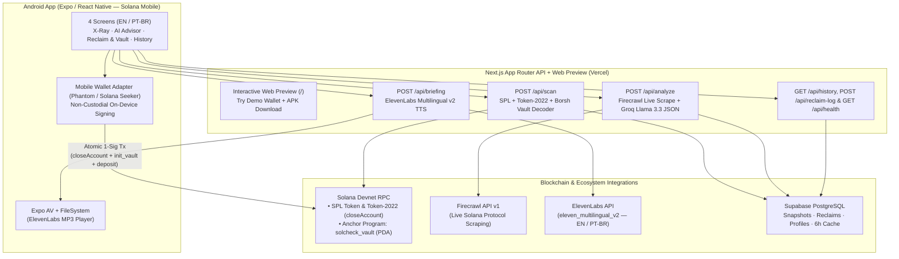

# SolCheck — AI Wallet Advisor, Rent Reclaim & Savings Vault on Solana Mobile

[](https://github.com/Bren0-lz/solcheck/actions/workflows/ci.yml)
[](https://github.com/Bren0-lz/solcheck/actions/workflows/android-apk.yml)
[](./LICENSE)
[](https://explorer.solana.com/address/7RCowC83nUELZmnPxC9PDZZpDAKprF5GGtuRnqc913Gp?cluster=devnet)
[](https://solanamobile.com/)

**Live Web Preview & API:** [https://solcheck-mu.vercel.app](https://solcheck-mu.vercel.app) · **Anchor Program ID (Devnet):** [`7RCowC83nUELZmnPxC9PDZZpDAKprF5GGtuRnqc913Gp`](https://explorer.solana.com/address/7RCowC83nUELZmnPxC9PDZZpDAKprF5GGtuRnqc913Gp?cluster=devnet) · **Android APK:** [GitHub Releases](https://github.com/Bren0-lz/solcheck/releases/latest)

> **One-line pitch:** SolCheck is a non-custodial AI financial advisor in your pocket for Solana wallets: it runs an instant on-chain wallet X-Ray, explains your wallet health in natural 30-second audio (**ElevenLabs**) grounded in live protocol documentation (**Firecrawl**), reclaims SOL locked inside empty SPL token accounts in one tap, and routes recovered value into an on-chain Savings Goal Vault (**Anchor/Rust** + **Supabase**).

---

## Why SolCheck?

1. **Hidden Locked SOL (Account Rent):** Every SPL token or airdrop creates an Associated Token Account (ATA) that locks **~0.00203928 SOL** for rent exemption. Even after selling or transferring the token to zero balance, the empty account stays open indefinitely until explicitly closed.
2. **Idle Capital & Risk Blindspots:** Users hold idle SOL or keep stale token delegations active without clear visibility.
3. **Jargon-Heavy Mobile UX:** Block explorers and DeFi docs are overwhelming on mobile. SolCheck turns raw on-chain state into a deterministic **0–100 Health Score**, live-sourced recommendations, a 30-second voice briefing (`EN` & `PT-BR`), and a **1-signature atomic Reclaim + Vault transaction**.

---

## Architecture



---

## Key Integrations

| Layer | Technology | How SolCheck Uses It |
| --- | --- | --- |
| **Solana Mobile** | Expo Custom Dev Build + `@solana-mobile/mobile-wallet-adapter-protocol-web3js` | Native Android connection & 1-tap biometric transaction signing with Phantom / Solana Seeker (`solana:devnet`). |
| **On-Chain Program** | Rust / Anchor (`solcheck_vault`) + SPL Token / Token-2022 | Non-custodial user PDA (`["vault", owner]`) tracking savings goals (`initialize_vault`, `deposit`, `withdraw`, `update_goal`) and rent-reclaim routed SOL. |
| **Firecrawl** | Firecrawl Scrape API v1 | Live markdown extraction of Solana rent, staking, and vault docs with 6-hour Supabase caching and transparent source badges. |
| **ElevenLabs** | `eleven_multilingual_v2` TTS | Dynamic 30-second spoken financial briefings in both **English (`EN`)** and **Brazilian Portuguese (`PT-BR`)**. |
| **Supabase** | PostgreSQL + Row-Level Security | Persists wallet profiles, Health Score evolution snapshots, verifiable transaction logs, and Firecrawl research cache. |

---

## Monorepo Structure

```text
solcheck/
├── apps/
│   ├── api/                    # Next.js 15 App Router API + Interactive Web Preview (Vercel)
│   └── mobile/                 # Android Expo Router App + Solana Mobile MWA
├── programs/
│   └── solcheck_vault/         # Anchor / Rust smart contract + IDL + Solana Playground tests
├── supabase/
│   └── schema.sql              # PostgreSQL tables, indexes, and RLS policies
├── scripts/
│   ├── seed-dirty-wallet.ts    # Creates 8 empty SPL ATAs on Devnet for live demo testing
│   └── set-program-id.ts       # Propagates deployed Program ID across Rust, IDLs & env files
├── tests/                      # Automated unit tests (Health Score, Borsh codec, MTU packet proof)
├── docs/
│   └── DEPLOY_AND_DEMO_RUNBOOK.md
└── shared/
    └── types.ts                # Shared TypeScript API & on-chain contracts
```

---

## Smart Contract (`solcheck_vault`)

- **Network:** Solana Devnet
- **Program ID:** Set via `npx tsx scripts/set-program-id.ts <PROGRAM_ID>` after deploying [`programs/solcheck_vault/src/lib.rs`](./programs/solcheck_vault/src/lib.rs) on [Solana Playground (`beta.solpg.io`)](https://beta.solpg.io/).
- **PDA Seeds:** `["vault", owner.key().as_ref()]` (`109 bytes` total space)
- **Instructions:**
  1. `initialize_vault(goal_name: String, target_lamports: u64)`
  2. `deposit(amount: u64, from_reclaim: bool)`
  3. `withdraw(amount: u64)`
  4. `update_goal(goal_name: String, target_lamports: u64)`

---

## Quick Start & Verification

See [`docs/DEPLOY_AND_DEMO_RUNBOOK.md`](./docs/DEPLOY_AND_DEMO_RUNBOOK.md) for the step-by-step Devnet + Supabase + Vercel + Android APK deployment guide.

```bash
# Install dependencies across workspaces
npm install
npm --prefix apps/api install
npm --prefix apps/mobile install --legacy-peer-deps

# Run unit tests, monorepo typechecks, and Next.js production build
npm test
npm run typecheck
npm run build:api
```

### API Endpoints (`apps/api`)
- `GET /api/health` — Integration readiness check (RPC, Anchor Vault ID, Supabase, Firecrawl, Groq, ElevenLabs)
- `POST /api/scan` — On-chain SPL + Token-2022 + Borsh `VaultAccount` wallet X-Ray
- `POST /api/analyze` — Live Firecrawl protocol scrape + bilingual Groq Llama 3.3 JSON diagnosis
- `POST /api/briefing` — ElevenLabs `eleven_multilingual_v2` 30-second MP3 synthesis
- `POST /api/reclaim-log` & `GET /api/history` — Verifiable Supabase event & snapshot persistence

---

## License

Released under the [MIT License](./LICENSE).
